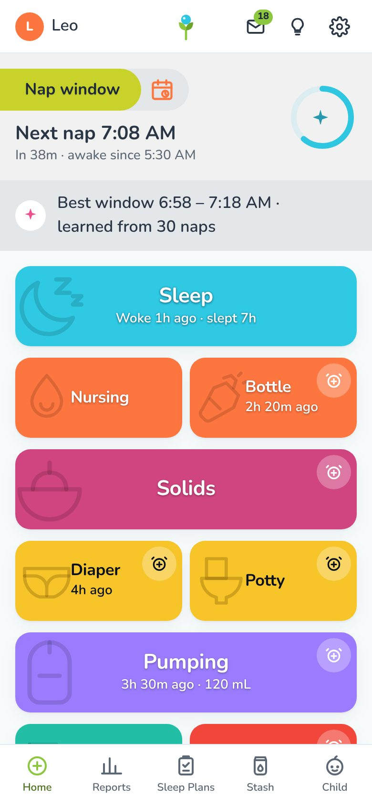
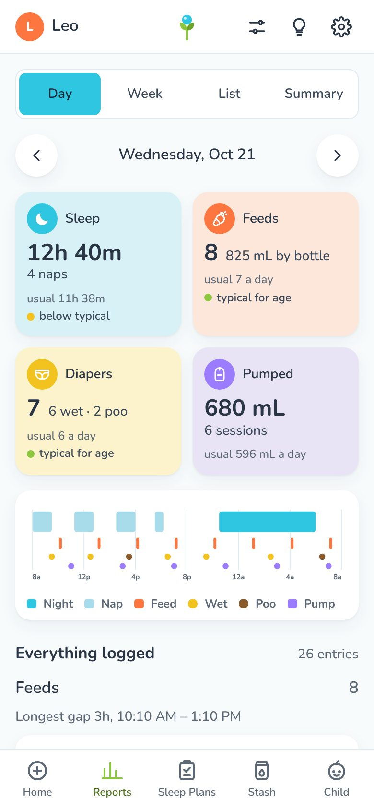
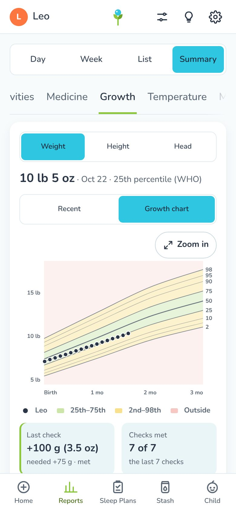
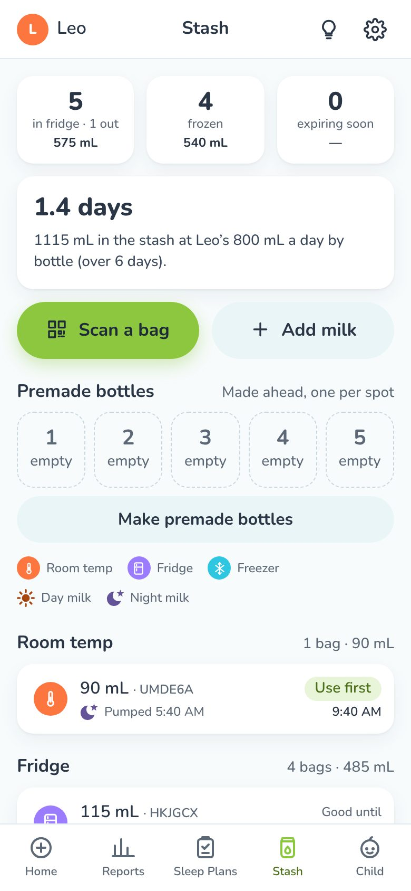
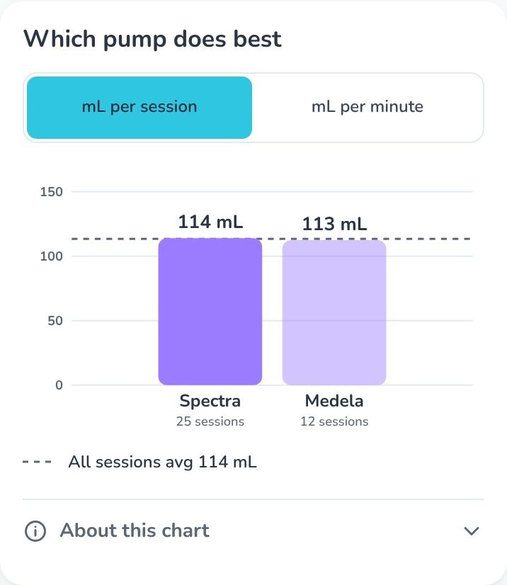
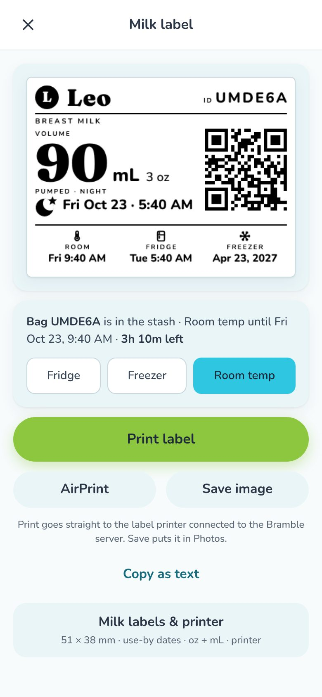

<p align="center">
  
</p>

<h1 align="center">Bramble</h1>

<p align="center">
  <b>A free, self-hosted baby tracker for the iPhone.</b><br />
  Log a feed in one tap, see what the week actually looked like, keep a breast-milk stash with QR-coded labels,<br />
  and keep going when the baby is born early or starts out in the NICU.<br />
  No subscription and no ads. The data stays on your own server.
</p>

<p align="center">
  
  
  
  
</p>

Bramble is a Progressive Web App (add it to the Home Screen and it behaves like an app) built on top of
[Baby Buddy](https://github.com/babybuddy/babybuddy), the open-source baby tracker. Baby Buddy stores the entries;
Bramble is the fast phone front end and a small companion service that adds what Baby Buddy doesn't have: a milk stash,
smart reminders, shared timers, people and roles, label printing, and a connection to a smart scale.

It was built for one family's newborn and is used by them every day; everything shown here is in that daily use.

## What it does

### Logging that takes a second
- One tile each for **sleep, nursing (left/right timers), bottle, solids, diapers, potty, pumping, medicine,
  temperature, growth, activities and milestones**, with alarms on the tiles you want reminders for.
- Logged it late? Every sheet has **Just now · 15 min ago · 30 min ago · 1 h ago** chips. The pumping sheet opens
  already set to your last session's length with the volume field ready, so you type the mL and save.
- **Type it**: write `60 ml bottle 3pm`, `wet diaper`, `pump 90` or `nap 1:30-2:15` and the right sheet opens filled
  in. Nothing is saved until you press Save.
- **Shared timers**: start a nap on one phone and it's running on the other.

### Reports that answer the question you had
- **Day**: four tiles (sleep, feeds, diapers, pumped), each against the baby's own week and the age-typical range;
  a 24-hour strip; and *Everything logged*, the day's entries by kind with the longest gap between feeds, so you can
  check that nothing was missed.
- **Summary**: every category over 7 days to a year. Tap any bar for its value.
- **Feeding by weight**: what the baby's latest weight suggests a day (150–180 mL/kg) right beside what was given.
- **Growth**: daily gain in grams against the pediatrician's goal, each weighing marked met or missed, and a
  **growth chart by age** with the WHO percentile bands the doctor's card uses.
- **A report for the pediatrician**: growth, daily averages and a day-by-day table, printed to PDF or shared as text.

<p align="center">
  
</p>

### Pumping and a breast-milk stash
- Save a pumping session and its **milk label prints by itself**: the volume, when it was pumped (with a sun or a moon
  for day or night milk), use-by dates for room, fridge and freezer (CDC guidelines), and a **QR code** for the bag.
- The **Stash** tab lists every bag by place, soonest deadline first. Scan a bag's QR when you make a bottle; a bottle
  takes only what was poured, and one bottle can come from several bags. You're warned before milk expires, and
  milk left out on the counter gets a "fridge it by" reminder.
- **Premade bottles** for the night (numbered fridge spots 1–5), **travel stickers** printed ahead for pumping away
  from home, and milk you already have (from the hospital) added with its real pumped time.
- **Which pump does best**, pumping this week against last week, and a nudge when supply drops three days in a row.
- Prints straight to a **Zebra** or **Brother QL** label printer on the network (or a Niimbot over Bluetooth through a
  small bridge), or through AirPrint and the share sheet.

<p align="center">
  
</p>

### Born early, or starting out in the NICU
- Set the **weeks of pregnancy at birth** and the **NICU stay** once. Every age-based figure then uses
  **corrected age** (feeds, sleep, wake windows, weight gain, WHO percentiles) until two.
- While the baby is in the NICU, Bramble shows what you log but doesn't compare it with age norms. The feed and diaper
  reminders stay quiet, because the nurses do that part.
- **Pumping for a NICU baby**: sessions a day against 8 (with one at night) and volume against what NICU lactation
  teams aim for (about 500 mL a day by day 7 and 750 by day 14). The first two weeks are never called low.
- The Stash turns into **Take to the NICU**: the bags going in leave the home stash in one tap, and **colostrum** is
  marked on the bag and the label so it goes first.

### For the whole family
- **One login per caregiver** with a role (Mom, Dad, Grandma…), so every entry says who logged it. Optional pings tell
  the other phones when someone logs a feed, so nobody feeds twice.
- A **simple screen for grandparents**: two huge buttons (bottle and diaper), no dates and no settings.
- **Notifications** worked out from what you log: feeding due, time to pump, no wet diaper in a while, an evening
  summary. Quiet hours are respected.

### Devices (optional)
- **Hatch Grow** smart changing pad: weighings arrive by themselves, with the time they were taken.

## How it works

```
 iPhone (Home Screen app)
        │  HTTPS
        ▼
 nginx ──► /            Bramble PWA (React + TypeScript, Vite)
       ──► /api/        Baby Buddy (Django): feeds, sleep, diapers, growth…
       ──► /bramble/    Companion (Python): stash, labels, reminders, Web Push,
                        people, timers, Hatch scale
```

Each family runs its own copy: its own Baby Buddy, its own companion, its own data. An old laptop, a mini PC or a
Proxmox container is plenty. Everything household-specific (people, printer, push contact, pumps, units, scale sign-in) is set from the app's Settings by the household's admin.

## Get started

1. Install [Baby Buddy](https://docs.baby-buddy.net/) and make it reachable over HTTPS.
2. Build Bramble (`npm ci && npm run build`), serve `dist/` with `deploy/nginx-bramble.conf`, and install the
   companion with `server/install.sh`.
3. Open it in Safari on the iPhone, tap Share › Add to Home Screen, and sign in with your Baby Buddy login.

The full walk-through is in **[docs/SELF-HOSTING.md](docs/SELF-HOSTING.md)**. To work on the code, see
**[docs/DEVELOPMENT.md](docs/DEVELOPMENT.md)**: a mock Baby Buddy, unit tests, server tests and Playwright probes that
run in light and dark mode without touching real data.

## Good to know
- **Not medical advice.** Age-typical ranges come from published guidance (WHO growth standards, AAP, CDC, sources
  listed in the app's Insights), but your pediatrician and NICU team come first.
- **iPhone web apps can't use Bluetooth, USB or Live Activities**, so label printing goes through the server or the
  share sheet, and there are no Lock Screen widgets.
- The Hatch connection uses Hatch's unofficial cloud API. It can stop working whenever Hatch changes something.

## Credits
- [Baby Buddy](https://github.com/babybuddy/babybuddy) (BSD 2-Clause): the backend everything is stored in.
- WHO Child Growth Standards; CDC breast-milk storage guidelines.
- Food photos: CC0, from rawpixel (list in `src/lib/food-credits.json`). Fonts: Nunito and Fraunces (SIL Open Font
  License), via Google Fonts.

## License
[MIT](LICENSE). Use it, change it, run it for your own family. Baby Buddy keeps its own BSD 2-Clause license.
